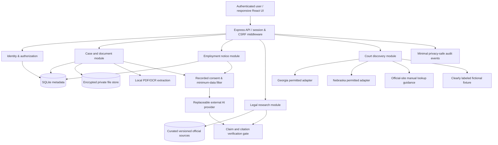

# Next Chapter Capstone — BMAD Architecture Spine

**Status:** Architecture decisions AD-01 through AD-10 approved, November 18, 2026. **Implementation status:** design only; no security or feature verification implied.

## Product boundary and operating principle

Build an accessible, responsive legal-information and reentry-assistance web application. Initial users are people with criminal records, their authorized supporters, and legal-aid stakeholders. The MVP has five capabilities: (1) accounts and private document protection, (2) case document organization and plain-language summaries, (3) employment pre-adverse/adverse-action notice assistance and user-approved drafts, (4) verified jurisdiction-specific legal information, and (5) court case discovery. The initial research focus is Georgia and Nebraska.

**No False Hope:** never invent legal eligibility, deadlines, court matches, citations, or outcomes. Show uncertainty and appropriate referrals. This is legal information, not a substitute for a qualified attorney. No real-user data or production claims before legal and security review.

## Architecture decisions — binding record

| ID | Approved decision | Binds / prevents |
|---|---|---|
| AD-01 | Modular monolith, separated into domain modules | One deployable backend; avoid premature microservices and uncontrolled cross-module access. |
| AD-02 | Responsive web app using React, Vite, TypeScript, Node.js and Express | Browser-first, mobile-friendly; no desktop-app dependency for MVP. |
| AD-03 | Local-first development with SQLite metadata and separately encrypted document storage | Never store private files in Git; preserve clear storage boundaries. |
| AD-04 | Provider-independent cloud AI with explicit consent, source verification, and no automatic legal conclusions | Runtime AI provider is replaceable; development agents are separate from runtime providers. |
| AD-05 | Court adapters for permitted live integrations, clearly labeled fictional demonstration data, and guided manual fallback | Georgia/Nebraska adapters normalize candidates; never bypass CAPTCHA, paywalls, terms, or access controls; never treat a name match as identity proof. |
| AD-06 | Maintained server-side authentication library, secure sessions, Argon2id, per-resource authorization, encrypted files | No hand-rolled cryptography or authentication; no cross-user access. |
| AD-07 | Curated, versioned authoritative legal sources with RAG, claim-level citation verification, jurisdiction/date checks, and abstention | Do not trust uncited model recollection; citation presence alone does not prove support. |
| AD-08 | Local-first PDF text extraction and OCR where supported; external AI processing only after explicit consent | Users can manage documents without cloud AI; no silent provider sharing. |
| AD-09 | Strict quality gates: DeepSeek builds, Codex independently tests, Claude reviews; evidence and owner approval required before merge | Failed critical tests, unresolved critical security issues, or legal-safety failures block main. |
| AD-10 | Both local and restricted hosted demonstrations; protected backups and tested recovery | Fictional data only for demos; hosted access restricted; no public production release. |

## Logical architecture

**Trust boundaries:** browser is untrusted; uploaded files, OCR text, external court pages, retrieved legal text, and model output are untrusted. The backend owns authorization, consent checks, encryption/decryption, legal verification policy, and all durable writes. No provider API key or encryption key is sent to the browser. Treat source content as evidence, not executable instructions.

## Core domain modules and contracts

- **Identity:** account, session, password reset, role/authorization, consent record. Use a maintained library, Argon2id and secure HttpOnly/SameSite cookies; TLS and CSRF defenses in hosted mode; login throttling and session revocation. No custom auth primitives.
- **Case & Documents:** case, document metadata, encrypted blob reference, extraction job, extracted text with provenance, user correction, AI summary with model/provider/time and source spans. Validate MIME by content, size, parsing limits, and file types; reject unsafe uploads; no cross-account object IDs.
- **Employment Notice:** notice type, original source span, explicitly stated dates, ambiguity flags, user-edited response draft. Never calculate an unstated legal deadline as fact; no automatic email sending or filing.
- **Legal Source Library:** source URL/authority, jurisdiction, effective/review dates, version, archived excerpt and provenance. Retrieval filters by jurisdiction and legal period. A claim-support gate checks that each material claim is actually entailed by cited passages; unsupported claims are withheld or labeled uncertain. Automated checks are fallible; human legal review is required before real use.
- **Court Discovery:** `CourtAdapter.search(query)` returns normalized `CandidateCase` objects with source, court, jurisdiction, case number if available, confidence/ambiguity and access status. Separate permitted Georgia/Nebraska adapters; explicit user selection before attaching a candidate. If access is unavailable, show official manual steps. Fictional results have unmistakable DEMO labeling and must never appear as live records.
- **AI Gateway:** provider-agnostic adapter; sends only data covered by explicit, specific, recorded consent. Consent UI shows provider, purpose, categories of data, and potential retention/sharing implications. Revocation prevents future transmissions but cannot retroactively erase provider-held data; disclose this. AI output never directly changes official case status or sends messages.

## Document and research flows

1. User authenticates; backend checks ownership and creates a document record.
2. Validate upload, encrypt and persist blob, record integrity checksum and metadata. Do not store document contents in logs.
3. Extract text locally from readable PDFs; attempt supported local OCR for scans. Preserve page/span references and extraction warnings. If extraction is unsupported or unreliable, show a clear limitation and allow manual correction.
4. Present an explicit consent choice before any external AI transmission. Denial leaves upload, organization, and local extraction available.
5. Minimize/redact transmitted data where feasible, invoke the chosen provider, retain provider and consent audit metadata without logging sensitive payloads.
6. Verify outputs against uploaded source spans and, for legal claims, curated authoritative legal sources with jurisdiction/date constraints. Flag conflicts or abstain. User reviews any draft before export.
7. Court search independently returns only verified-source candidates or labeled fixtures; user confirms selection; manual fallback remains available.

## Security, privacy, and operations invariants

- Every read/write/query scoped to authenticated user or explicitly authorized relationship; test horizontal and vertical access escalation.
- At-rest encryption for private documents; keys stored outside Git, DB backups, and file snapshots; hosted secrets injected via protected environment or secret store. Encrypt backups separately; ensure a documented key-recovery path.
- No real records, private database files, `.env` values, tokens, or encryption keys in repository, CI artifacts, telemetry, or demo screenshots.
- HTTPS/TLS for hosted use; restrict hosted demo to approved participants and fictional identities; use least-privilege credentials and short-lived access where practical.
- File uploads are untrusted; enforce content/type/size limits, safe parsing, malware controls appropriate to environment, and resource/time limits.
- Document deletion includes live storage and metadata; explain backup retention and expiry accurately. Test restore and deletion interactions.
- Prompt-injection attempts in files or sources must not change authorization, provider consent, citation policy, or tool access.
- Keep source version and AI provenance; never label a claim “verified” solely because an LLM says so.

## Environments and recovery

| Environment | Purpose | Data | Controls |
|---|---|---|---|
| Local | Development, agent tests, rehearsal | Synthetic/fictional only | Local secrets, encrypted storage, repeatable setup, backup/restore test |
| Restricted hosted demo | Instructor presentation and browser validation | Synthetic/fictional only | TLS, invite/allowlist or equivalent restriction, authenticated demo accounts, isolated secrets and storage, monitoring without sensitive payloads |
| Future production | Out of scope for capstone launch | No real data until separately approved | Independent security assessment, legal review, privacy policy, operational incident and retention plans |

**Recovery acceptance:** create a consistent snapshot of SQLite + encrypted files + necessary nonsecret metadata; keep keys separately and securely; restore into a clean test environment; verify login, document integrity, source provenance, and record/file correspondence. Demonstrate a failed-restore alert and recovery instructions. Never claim backups are safe without a successful restore test.

## Quality gates and evidence

- **Builder (DeepSeek):** implements scoped story on feature branch, runs relevant unit/integration tests, records commands/results, documents assumptions.
- **Independent tester (Codex):** writes or runs independent negative-path tests, especially account isolation, consent denial, malformed uploads, citations, deadlines, and court identity ambiguity. No self-certification by builder.
- **Reviewer (Claude):** reviews diff, threat model, dependency risk, data exposure, legal-safety claims, and test coverage; documents unresolved issues.
- **Owner:** reviews evidence, accepts or rejects; only then merge to main. Work-in-progress stays on branches.
- **Required:** unit, integration, end-to-end browser, authorization, adversarial prompt-injection, privacy/consent, and legal citation test suites. Record exact commands, exit codes, test counts, versions, and known limitations.
- **Blockers:** failing required tests, known critical security vulnerability, unauthorized disclosure, unsupported material legal claims, fictional/live mislabeling, or court results asserted as identity matches.
- **Target acceptance metrics:** 100% of critical workflows passing; zero *known* critical vulnerabilities; 100% of material legal claims supported or withheld in the test set; zero unauthorized disclosures in tests. These are test-set goals, not guarantees.

## Delivery sequence and feasibility gates

1. **Nov 18–22:** lock repo structure, threat model, official GA/NE court access feasibility, curated source list, story acceptance tests, demo hosting choice and cost/access constraints.
2. **Nov 23–29:** auth, case/documents, encryption, upload validation, local extraction, secure data boundaries, basic UI.
3. **Nov 30–Dec 6:** consent-gated AI gateway, notice assistant, curated RAG/citation verification, court adapters or manual fallback and fictional fixture.
4. **Dec 7–11:** independent test/review cycles, adversarial tests, hosted restriction, backup/restore rehearsal, presentation workflow.
5. **Dec 12–14:** final regression, rehearsals, private demonstrations, transparent limitations.

**Scope control:** if live court access is blocked by policy, cost, or technical limits, the approved labeled fictional demo plus official manual fallback satisfies the court-discovery MVP presentation path. OCR is best-effort where supported. Do not sacrifice consent, isolation, or citation safety to meet the schedule.

## Unresolved implementation choices (not architecture approvals)

Select and verify maintained authentication/session library and current dependencies; decide hosted platform, access restriction method and budget; determine practical OCR engine and performance on available hardware; verify permitted official court endpoints and terms; choose reviewed GA/NE source corpus; design exact encryption key management and backup retention. Record each as a small ADR before implementation. No external integration is presumed available until tested.
