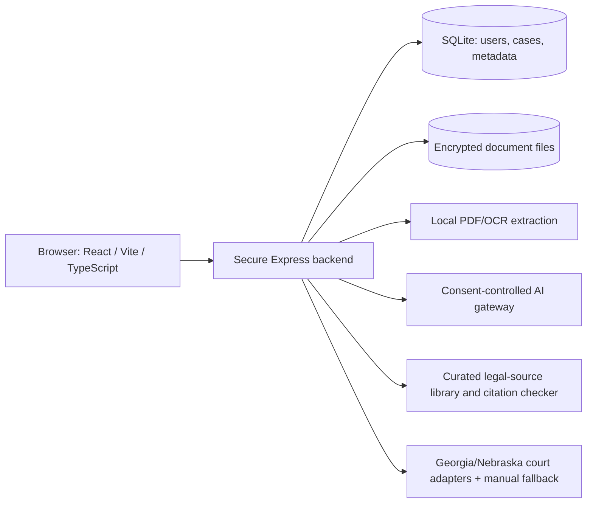

# Next Chapter Capstone — Instructor Technical Architecture Guide

**Presentation edition · November 18, 2026**

## What we're building

A responsive web application that helps people with criminal records and people navigating reentry organize legal documents, understand employment background-check notices, find trustworthy jurisdiction-specific legal information, and discover possible court records. It is designed to make complex information easier to understand, not to replace a lawyer.

**Core promise: “No False Hope.”** If a deadline, eligibility rule, court match, or legal conclusion cannot be supported, the application says so. It does not manufacture certainty.

## Five MVP experiences

1. **Secure account:** sign in and access only your own cases and files.
2. **Case organizer:** upload a PDF or image, extract text locally where possible, organize it, and request an AI summary only after consent.
3. **Employment notice assistant:** explain a pre-adverse or adverse-action notice, identify dates actually present in the document, and prepare a response draft for the user to review. Nothing is sent automatically.
4. **Verified legal information:** answer questions using a curated, versioned library of official sources, with jurisdiction, dates, and claim-level citations. If support is missing, explain uncertainty.
5. **Court discovery:** search through permitted official-source integrations where available; show candidates for user confirmation; otherwise offer guided official lookup. Fictional results in the demo are clearly marked as fictional.

## How the technology fits together

The frontend is the user experience. The backend checks identity and permissions, coordinates features, and prevents one user from opening another user's records. SQLite stores structured information; uploaded files are encrypted separately. Document extraction happens locally when practical. External AI is optional and consent-gated.

## Why this architecture

| Decision | Choice | Why it helps |
|---|---|---|
| 1 | Modular monolith | Faster to build and test than separate microservices, while keeping features organized. |
| 2 | Responsive React/TypeScript web app | Works on laptop and phone browsers; no installation required. |
| 3 | Local-first + SQLite + encrypted file store | Simpler development and clear separation of metadata and private documents. |
| 4 | Replaceable cloud AI, consent, verification | Avoids dependency on one AI vendor and gives users control over sharing. |
| 5 | Permitted court adapters + labeled demo + manual fallback | Respects court access restrictions and avoids invented court matches. |
| 6 | Maintained auth library, Argon2id, secure sessions | Reduces risks from custom authentication and enforces account boundaries. |
| 7 | Curated official-source RAG with claim checks | Grounds legal explanations in inspectable sources rather than guesses. |
| 8 | Local extraction/OCR before optional cloud AI | Protects privacy and allows document organization without AI consent. |
| 9 | Strict independent quality gates | Separates building, testing, reviewing, and approval. |
| 10 | Local and restricted hosted demos, backups, restore tests | Supports a reliable presentation without exposing real legal records. |

## Example user journey: employment notice

1. A fictional demo user signs in and uploads a sample background-check notice.
2. The server checks the file, encrypts it, and extracts readable text locally.
3. The user can inspect extracted facts and correct errors.
4. Before any external AI request, the app explains what information would be sent, to which provider, and why; the user may decline.
5. If approved, AI drafts a plain-language explanation and possible response. The application compares factual claims with the uploaded text and uses authoritative sources for any legal claims.
6. The user sees cited facts, warnings about unclear dates, and an editable draft. The application does **not** send the response.

## What makes it safer

**Privacy:** account-based access; encrypted documents; minimum-data sharing; consent records; no sensitive data in Git or logs.

**Legal reliability:** citations tied to actual passages, state/date applicability, explicit uncertainty, and no guarantees of relief or outcomes.

**Court records:** only permitted integrations; ambiguous results are candidates, never confirmed identities; guided manual official lookup when automation is blocked.

**AI resilience:** uploaded text and webpages are treated as untrusted evidence, not commands. The AI provider can be changed without rewriting the entire app.

**Limits:** automated checks can miss errors. A successful demo does not establish production security or legal accuracy. Human legal and security review are prerequisites for real-user use.

## How we build and validate it

**DeepSeek → Codex → Claude → Owner approval**

DeepSeek implements a story and runs tests. Codex independently challenges the result, including negative and security cases. Claude reviews code, threats, and legal-safety assumptions. The owner examines evidence before merging. Failed critical tests or unresolved critical issues block the main branch.

The capstone's test goals are: all critical workflow tests passing; no *known* critical vulnerabilities; all material legal claims in the test set supported or withheld; no unauthorized data disclosure in testing. Test reports must show commands, results, and limitations.

## Demonstration plan

**Local environment:** show the application working on the development laptop using fictional users and documents. Demonstrate document upload, consent denial, AI-assisted explanation, citation checks, court candidate handling, and uncertainty messaging.

**Restricted hosted environment:** show the same fictional workflows in a hosted browser environment accessible only to approved reviewers, protected by HTTPS, authentication, and additional access restrictions. No real records or production launch claims.

**Recovery proof:** take an encrypted, consistent backup of the database and document files; restore it in a clean test environment; confirm that cases and files still match and remain readable to the correct fictional account.

If a live official court integration is unavailable or prohibited, demonstrate the **clearly labeled fictional search fixture** and guided lookup on the official court website. Explain the limitation openly.

## Proposed schedule

| Period | Milestone |
|---|---|
| Nov 18–22 | Architecture, security planning, court feasibility, source selection |
| Nov 23–29 | Accounts, encrypted documents, local extraction, base UI |
| Nov 30–Dec 6 | AI consent, employment assistant, legal-source retrieval, court discovery paths |
| Dec 7–11 | Independent testing, security review, hosted demo, restore testing |
| Dec 12–14 | Final checks, rehearsal, capstone presentation |

## Short presentation explanation

> My capstone is a legal-information and reentry support platform built around a simple principle: no false hope. Users can securely organize case documents, understand employment background-check notices, research legal information with official citations, and explore possible court records. The system is a responsive React web application backed by Express, SQLite, and encrypted document storage. It extracts text locally when possible, asks permission before sending anything to external AI, and checks legal claims against a curated source library. Court access uses permitted integrations where possible and an honest manual fallback where it isn't. We're developing it with separate building, testing, and review roles, and we'll demonstrate it locally and in a restricted hosted environment using fictional data. The goal is to make legal information more accessible without pretending that AI replaces a lawyer.

## Current status and next action

All ten architecture decisions are approved. **This is a design, not a claim of completed implementation.** Next: create the repository skeleton, implementation ADRs, threat model, prioritized stories, and the first tested vertical slice (sign-in → private case → encrypted document upload). Confirm hosted provider and official court-source feasibility before relying on either for the demo.
